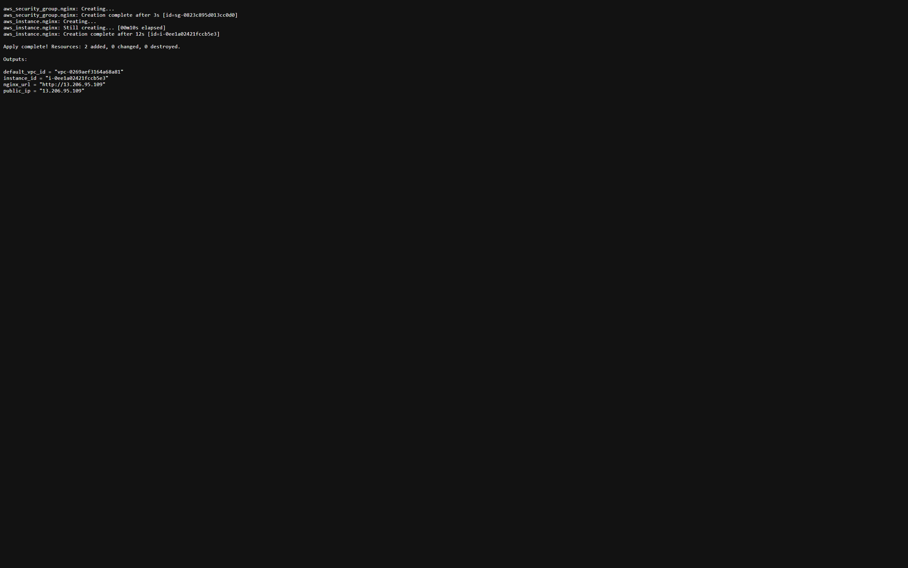
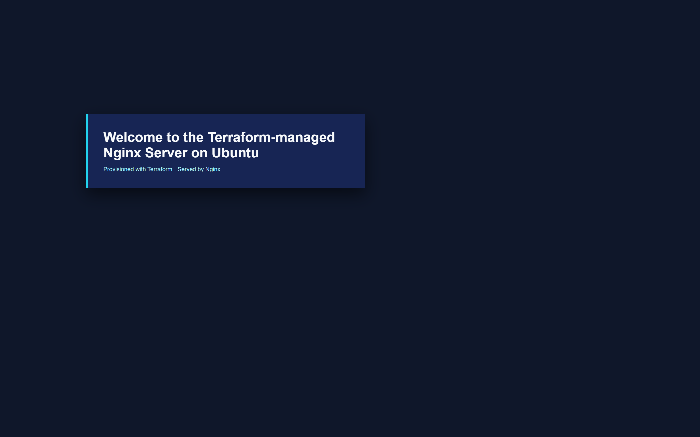
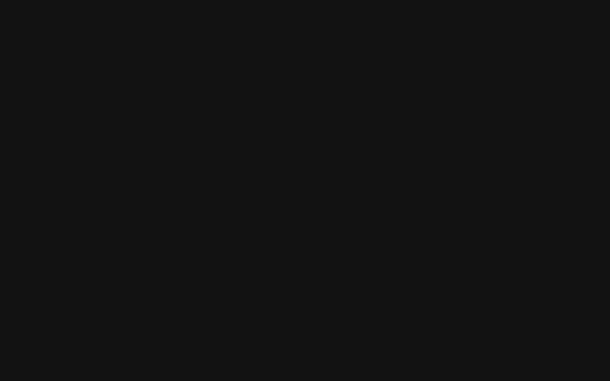
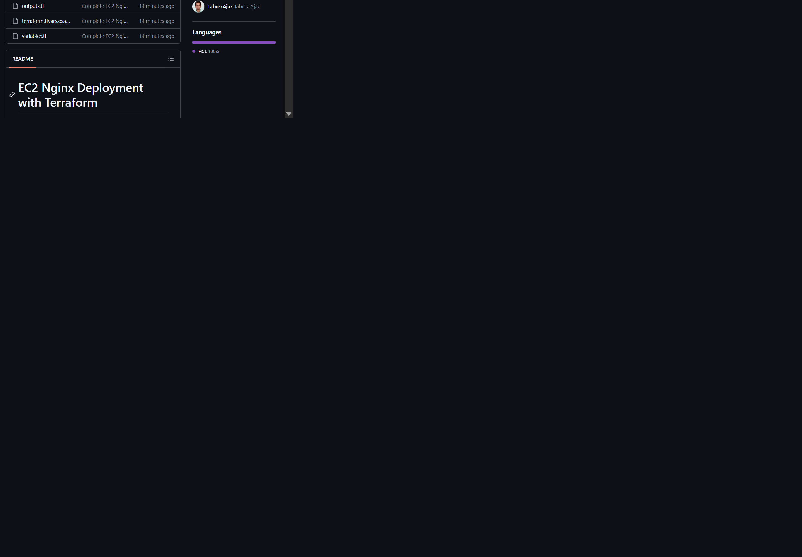

# EC2 Nginx Deployment with Terraform

This repository completes the HeroVired assignment **EC2 Nginx Deployment with Terraform**. It uses Terraform CLI to launch exactly one Ubuntu 20.04 LTS `t2.micro` EC2 instance in the existing AWS default VPC, install Nginx through `user_data`, publish a custom page, output the public IP, and remove all created resources with `terraform destroy`.

## Submission Report

- [Polished HTML implementation report](docs/Implementation_Report.html)
- [Submission-ready PDF report](Tabrez_Ajaz_EC2_Nginx_Terraform_Report.pdf)

## Resources

- Existing default VPC and one existing default subnet, queried through data sources
- One security group allowing public HTTP and SSH only from `admin_cidr`
- One official Canonical Ubuntu 20.04 LTS `t2.micro` EC2 instance
- Encrypted, delete-on-termination 8 GiB gp3 root volume

No VPC, subnet, route table, NAT Gateway, or Internet Gateway is created.

## Custom page

The EC2 `user_data` script installs Nginx and writes:

> Welcome to the Terraform-managed Nginx Server on Ubuntu

## Run

1. Authenticate AWS CLI and select an existing EC2 key pair.
2. Copy `terraform.tfvars.example` to the ignored `terraform.tfvars`.
3. Set your AWS profile, key-pair name, and current public IP as `/32`.
4. Run only the required Terraform CLI commands:

```powershell
terraform init
terraform plan -out=assignment.tfplan
terraform apply assignment.tfplan
terraform output -raw public_ip
```

Open the printed `nginx_url` in a browser.

## Destroy

```powershell
terraform destroy -auto-approve
```

After teardown, `terraform state list` should be empty and the EC2 instance should be terminated.

## Evidence

The configuration was deployed and verified on 18 October 2026:

- Ubuntu 20.04 AMI: `ami-06cc5ebfb8571a147`
- Instance type: `t2.micro`
- Default VPC: `vpc-0269aef3164a68a81`
- EC2 instance: `i-0ee1a02421fccb5e3`
- Public IP during verification: `13.206.95.109`
- Custom page returned the exact required welcome text
- Final teardown: `Destroy complete! Resources: 2 destroyed.`

### Terraform Apply



### Custom Nginx Page



### Terraform Destroy



### Public GitHub Repository



## Security

- Port 80 is public as required.
- Port 22 is restricted to the administrator CIDR rather than `0.0.0.0/0`.
- IMDSv2 is mandatory and the root volume is encrypted.
- Terraform state, plans, PEM files, and real variable values are excluded from Git.
